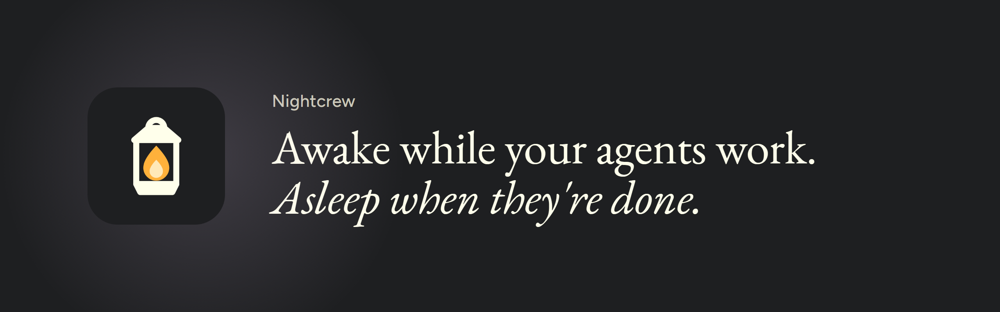
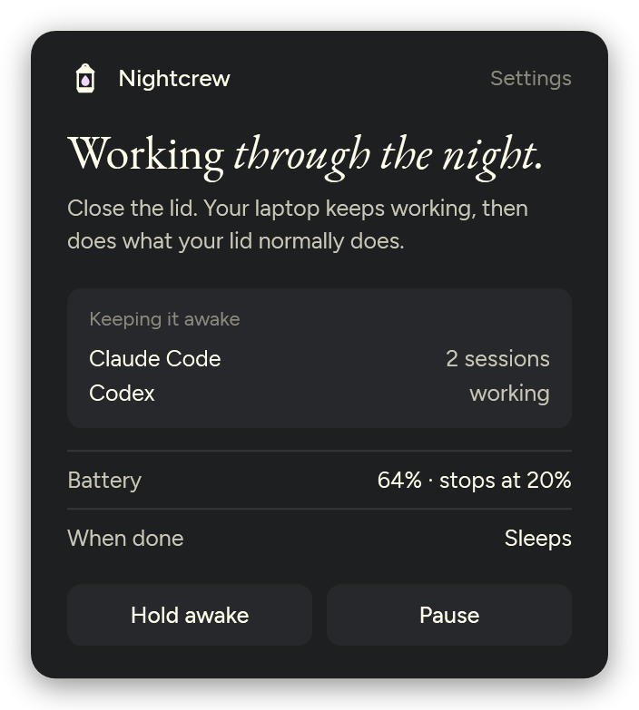
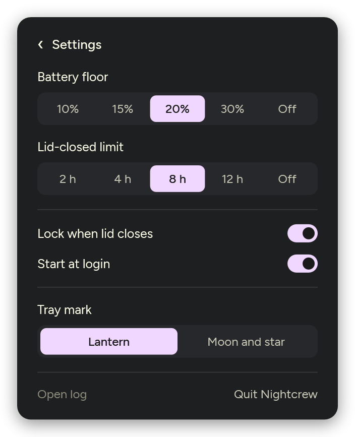
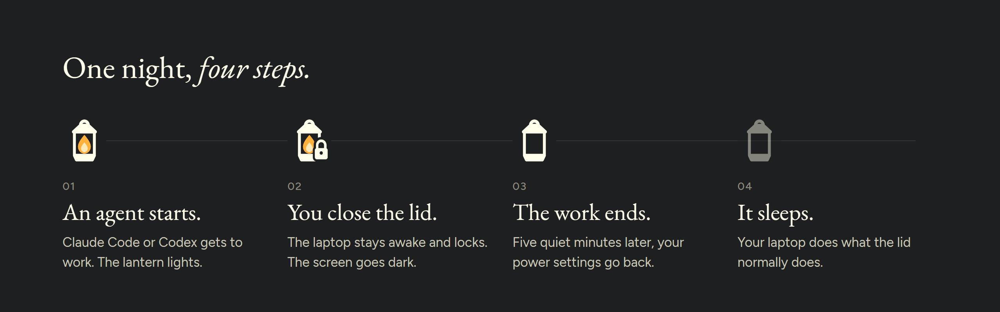
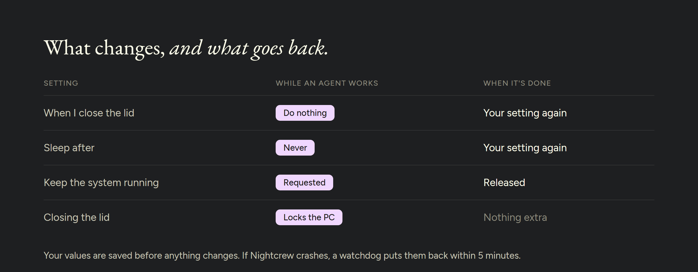

  

  
  
  

Close your laptop and walk away while Claude Code or Codex keeps working.

- While an agent is working, Nightcrew keeps a Windows laptop awake with the
  lid closed.
- When the work ends, it puts your power settings back and does what your lid
  action says: sleep, hibernate or nothing.
- It lives in the tray. There's nothing to set up.

> [!WARNING]
> **Heat.** A closed laptop in a bag has almost no airflow. Don't run hard
> jobs, such as long builds or GPU work, in a closed bag. Nightcrew doesn't
> watch temperatures.

## Install

1. Download `nightcrew.exe` from [Releases](../../releases/latest).
2. Move it to a folder where it can stay, for example
   `%LOCALAPPDATA%\Programs\Nightcrew`. Start at login and the watchdog task
   remember this path.
3. Run it. The lantern appears in the tray.

Nightcrew needs Windows 10 (1903 or later) or Windows 11. It uses
.NET Framework 4.8, which is already part of Windows.

Nightcrew isn't code-signed. The first time you run it, SmartScreen shows
"Windows protected your PC". Click **More info**, then **Run anyway**. If
Smart App Control is on, it blocks unsigned apps it doesn't already trust and
offers no Run anyway, so Nightcrew may not start.

Each release includes `nightcrew.exe.sha256` and a GitHub build attestation.
To check your download, run `Get-FileHash .\nightcrew.exe` and compare the
hash with the one in that file.

## Using it

The lantern in the tray shows what Nightcrew is doing:

- **Unlit.** Nightcrew isn't keeping the laptop awake. Close the lid and
  Windows does what it normally does.
- **Flame.** An agent is working and Nightcrew is keeping the laptop awake.
  Close the lid and it keeps going.
- **Filled.** The same, with the lid closed.

If an agent is working but Nightcrew can't keep the laptop awake, for example
because a policy blocks it, the lantern stays unlit and the panel tells you to
keep the lid open.

Click the lantern to open the panel. It says who is keeping the laptop awake,
your battery, and what happens when the work is done. **Hold awake** keeps the
laptop awake until you turn it off. **Pause** hands the lid back to Windows
until you resume.

 

Click **Settings** in the panel, or right-click the lantern, for the settings
page. Changes save as soon as you make them. **‹** or Esc goes back.

- **Battery floor.** 10, 15, 20 or 30%, or Off.
- **Lid-closed limit.** 2, 4, 8 or 12 hours, or Off.
- **Lock when lid closes.**
- **Start at login.**
- **Tray mark.** The lantern, or a moon and star.
- **Open log.**
- **Quit Nightcrew.** Puts your settings back, then exits.

 

### How it decides an agent is busy

Every 10 seconds Nightcrew looks for any of these:

- **Transcripts.** A Claude Code or Codex session file (`*.jsonl` under
  `%USERPROFILE%\.claude\projects` or `%USERPROFILE%\.codex\sessions`) grew,
  or a new one appeared.
- **Agent tool processes.** A program started by `claude` or `codex`, such as
  a build, a test run or a script, used at least 10% of one CPU core. Codex
  itself counts at 2%.
- **GPU.** Any process kept a GPU engine at least 30% busy. A game or a video
  counts too.
- **Hold awake.** You turned it on. It counts as busy until you turn it off.

Work counts as live until 5 minutes after the last busy check. The panel lists
each of these under "Keeping it awake".

## What happens when the lid closes

While work is live, Nightcrew:

- sets the lid-close action to Do nothing and "Sleep after" to Never, on mains
  power and on battery
- asks Windows to keep the system running
- locks the PC when you close the lid during work, or when work starts while
  the lid is already closed and there has been no keyboard or mouse input for
  5 minutes (turn off **Lock when lid closes** if you don't want that)

When the work ends, Nightcrew puts your settings back. If the lid is open,
that's all. If the lid is closed, it waits until there has been no keyboard or
mouse input for 5 minutes, then follows your Windows lid action for the
current power source:

- **Sleep.** It turns the screen off and lets Windows sleep. If the laptop is
  still awake 5 minutes later, it hibernates.
- **Hibernate** or **Shut down.** It hibernates.
- **Do nothing.** The laptop stays on, as your setting says.

If work starts again first, Nightcrew keeps the laptop awake again. If you open
the lid first, it does nothing.

Your lid action is in Settings > System > Power & battery > Lid & power button
controls, or in Control Panel > Power Options > Choose what closing the lid
does.

### Battery floor and lid-closed limit

With the lid closed, Nightcrew stops early and hibernates, even if an agent is
still working, when:

- it's on battery and the charge falls to the battery floor (default 20%), or
- the lid has been closed for the lid-closed limit (default 8 hours).

It puts your settings back first. After that it won't keep the laptop awake
again until you open the lid. If hibernation is turned off on your PC
(`powercfg /a` lists what's available), Windows' own sleep timer takes over
instead.

The battery floor applies whenever the lid is closed on battery, even while
you work on a docked laptop. The lid-closed limit counts only time without
keyboard or mouse input, which starts 5 minutes after your last input, so
time spent working on a docked laptop with its lid closed doesn't count
toward it.

## How it puts things back

Nightcrew saves your original values in `%LOCALAPPDATA%\Nightcrew\restore.json`
before changing anything. If you change one of these settings yourself while
Nightcrew is working, your change is kept.

It puts your settings back when the work ends, when you pause or quit it, when
you sign out or shut down, and the next time it starts after a crash or a
power cut. If Nightcrew crashes or is killed, a scheduled task called
Nightcrew Watchdog puts your settings back within 5 minutes.

If your organization's policy locks the power settings, Nightcrew can't change
them. It stays idle and the panel says so.

## Limits

- Don't switch Windows power plans while an agent is working. Nightcrew puts
  your settings back into the plan that is active at that moment, so the plan
  you switched away from keeps Do nothing and Never.
- A game or video that keeps a GPU engine at least 30% busy counts as busy,
  so the laptop stays awake while it runs.
- If the laptop leaves your Wi-Fi, for example in a bag, the agent loses its
  connection. To have Windows switch to your phone's hotspot by itself, open
  Settings > Network & internet > Wi-Fi > Manage known networks, select the
  hotspot and turn on **Connect automatically when in range**.

## Other agents

Nightcrew knows Claude Code and Codex. Any other agent is covered when it
uses the GPU, or when you turn on **Hold awake**. To teach Nightcrew about
another agent, edit `%LOCALAPPDATA%\Nightcrew\settings.json`:

- Add its process name to `AgentProcessNames`, so programs it starts count
  as agent tools.
- Add it to `SelfCpuAgentNames` too if the agent does its work in its own
  process.
- Add the folder where it writes `*.jsonl` session files to `TranscriptRoots`.

Quit Nightcrew before editing the file, then start it again. A key you leave
out keeps its default. The log is `nightcrew.log` in the same folder.

| Key | Default | Meaning |
|---|---|---|
| `GraceMinutes` | 5 | How long work stays live after the last busy check |
| `BatteryFloorPercent` | 20 | Hibernate at this charge with the lid closed and on battery; 0 = off |
| `LidClosedCapHours` | 8 | Hibernate after this long with the lid closed and no input; 0 = off |
| `AwayMinutes` | 5 | Minutes without input before the lid action runs, before lid-closed time counts toward the limit, and before the lock when work starts with the lid closed |
| `LockOnLidClose` | true | Lock the PC when the lid closes |
| `StartAtLogin` | true | Start Nightcrew when you sign in |
| `DryRun` | false | Log what Nightcrew would do without doing it |
| `TranscriptRoots` | Claude Code and Codex folders | Where session files are watched |
| `IgnorePathContains` | `claude-mem-observer` | Session files whose path contains this are ignored |
| `AgentProcessNames` | `claude`, `codex` | Agent processes; programs they start count as agent tools |
| `SelfCpuAgentNames` | `codex` | Agents whose own CPU use counts |
| `SelfCpuPercent` | 2 | CPU threshold for those agents, % of one core |
| `ToolCpuPercent` | 10 | CPU threshold for agent tools, % of one core |
| `GpuPercent` | 30 | GPU engine threshold, % |
| `SampleSeconds` | 10 | Seconds between checks |
| `Mark` | `lantern` | The tray mark: `lantern` or `moon` |

To watch what Nightcrew would do without letting it change anything, run
`nightcrew --dry-run` and read the log.

## Uninstall

1. Quit Nightcrew from the tray.
2. Open a terminal in the folder that holds the exe and run
   `.\nightcrew.exe --uninstall`. It puts your power settings back, removes
   Start at login and deletes the Nightcrew Watchdog task.
3. Delete `nightcrew.exe`. To remove settings and logs too, delete
   `%LOCALAPPDATA%\Nightcrew`.

## Credits

- The idea and the plain, honest voice come from
  [Insomnia](https://github.com/krishhgg/Insomnia) by Krish Garg.
- The cream ink, serif headline and lavender come from Wispr Flow's design
  language.
- Type is [EB Garamond](https://github.com/octaviopardo/EBGaramond12) and
  [Figtree](https://github.com/erikdkennedy/figtree), both under the SIL Open
  Font License. See [THIRD-PARTY-NOTICES.md](THIRD-PARTY-NOTICES.md).

## License

MIT
